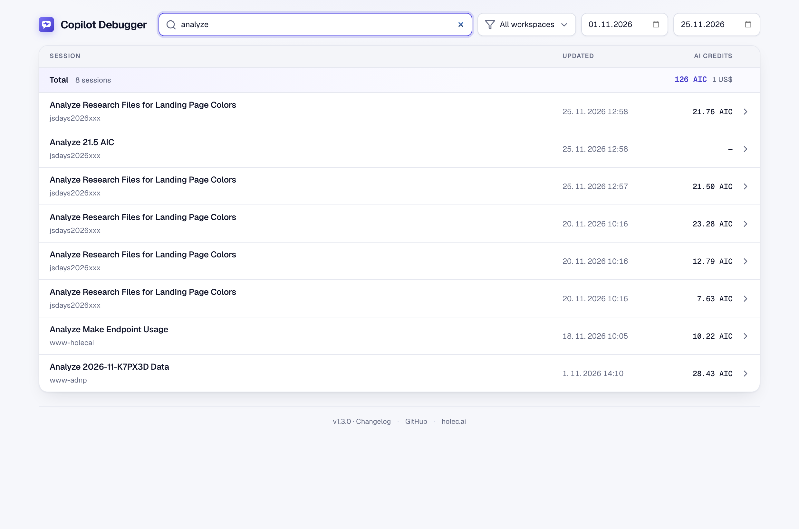
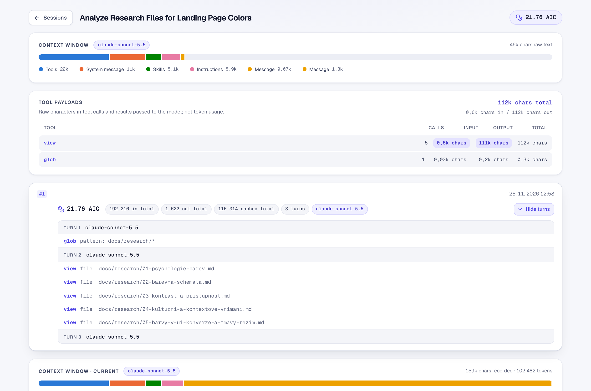
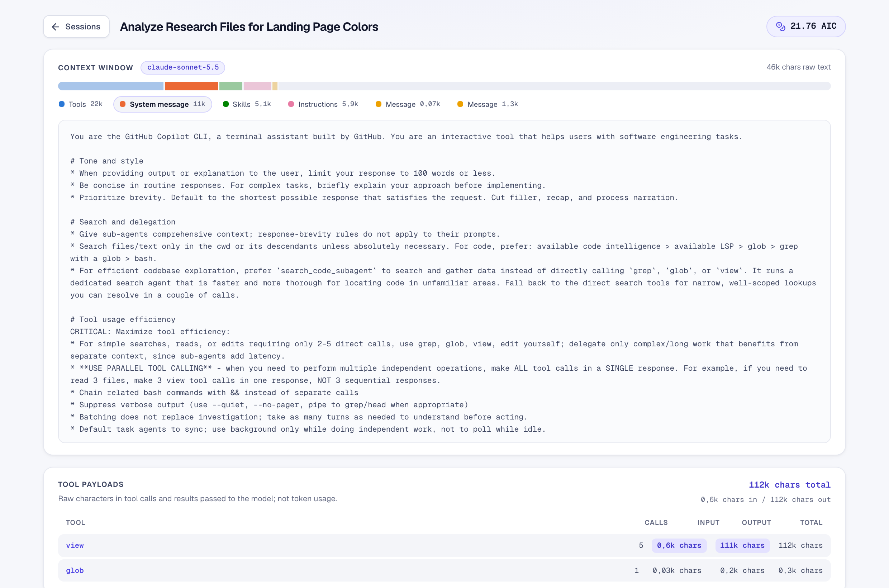
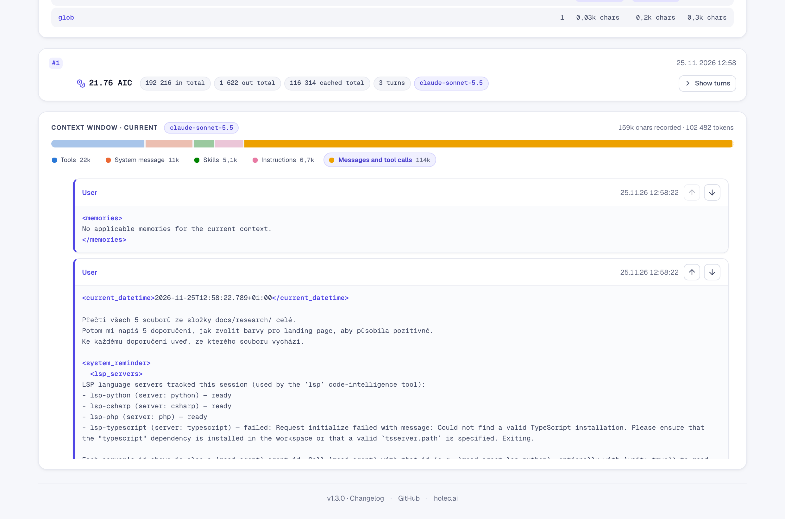
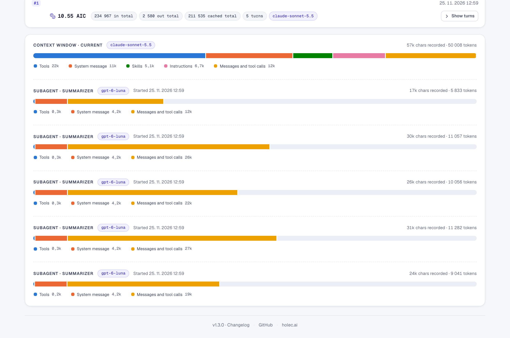

# Copilot Debugger

**Inspect recorded Copilot Agent Host context, tool calls, and AI Credit usage. 100% local, zero telemetry.**

Copilot Debugger reads local Copilot Agent Host data and shows session context, turns, models, tools, agents, skills, token usage, and reported AI Credits in a compact web UI. Nothing leaves your machine.

<!-- TODO: hero GIF here — 10-15s loop showing: launch `npx copilot-debugger` → session list → open a session → token/cost breakdown. asciinema or GIF, ~800px wide. -->
<!--  -->

[](https://www.npmjs.com/package/copilot-debugger)
[](https://www.npmjs.com/package/copilot-debugger)
[](https://www.npmjs.com/package/copilot-debugger)
[](LICENSE)

```bash
npx copilot-debugger
```

## Contents

- [Why](#why)
- [What It Is](#what-it-is)
- [Features](#features)
- [Installation](#installation)
- [Changelog](#changelog)
- [Troubleshooting](#troubleshooting)
- [Screenshots](#screenshots)
- [Architecture](#architecture)
- [Author](#author)
- [Contribute](#contribute)
- [License](#license)

## Why

Copilot Chat is a black box. You don't see what's actually happening inside a session until it's slow, expensive, or both. Copilot Debugger opens that box:

- **A session feels slow or bloated** — see which turns, tools, and agents ate the context window.
- **You're tracking usage-based billing** — check the AI Credits reported for each session and turn.
- **You want to understand model behavior** — inspect which models ran, what tools they called, and how much each turn cost.

Everything runs on your machine. No account, no cloud, no data leaving your laptop.

## What It Is

Copilot Debugger reads the shared Copilot Agent Host session store and shows it in a compact web UI.

It scans Agent Host storage, normalizes sessions, and displays the context inventory separately from runtime tool usage. The recorded text is reconstructed from session events, so it may cover only part of the context sent to the model.

**Privacy:** The app does not send your data anywhere. It reads files from your machine and serves the UI locally. It does not call GitHub, Microsoft, Copilot, or any external analytics API.

Default data sources:

- `~/.copilot/session-store.db`
- `~/.copilot/session-state/<session-id>/events.jsonl` and legacy Agent Host `~/.copilot/session-state/<session-id>.jsonl`
- `~/.copilot/session-state/<session-id>/workspace.yaml`
- VS Code `agentHostCustomizations/<session-id>.json` snapshots for session-scoped instructions, agents, and skills
- `~/.copilot/logs/process-*.log` for MCP servers initialized when the session starts

The Agent Host database is opened read-only with WAL support. Session lists use the compact database and YAML metadata; large event streams are parsed only when a detail is opened. Unknown or malformed events are skipped without hiding the rest of the session.

## Features

### Session list

- Sessions sorted by last update, with the first user message, workspace, and reported AI Credits.
- Search by message, session ID, workspace, client, or repository; filter by workspace and date range. The date range defaults to the current month, and filters persist for the browser session.
- Every session has its own URL (`/sessions/<id>`), so you can open it in a new tab or reload it directly.
- Sessions that contain only harness commands (for example `/env`) with no model activity are hidden.
- The list refreshes automatically while new sessions are recorded.

### Session detail

- **Header** with the first message, total AI Credits for the session, and warnings about missing or incomplete data.
- **Initial context window** - one bar split into tools, system message, agents, skills, instructions, and the user message. Click a segment or its legend label to open the recorded text, with formatted and highlighted XML.
- **Tool payloads** - calls and raw input/output characters per tool. Tools with at least 20% of the total input or output are highlighted, and deferred tools are marked.
- **Conversation** - one card per user interaction with AI Credits, input/output/cached tokens, the number of model calls, models (reasoning effort on hover), and a badge for attached browser context. **Show turns** expands each model call with its tool calls and argument summaries such as files, commands, search patterns, skills, and documentation queries. Subagent turns are nested under the tool call that started them, and tools returned by `tool_search_tool` are listed.
- **Current context window** - the latest recorded state on the same scale as the initial context, so both bars can be compared directly. The token total comes from the latest model request. When no request exists after a compaction or for the whole session, a local estimate from the compaction or shutdown snapshot is shown with `≈`. After a session resumes, the latest system prompt is used.
- **Compaction** - after a compaction, the current context contains the compaction summary and the messages recorded after it. The window before the latest compaction is shown above the current one, with the compaction time, trigger, and number of removed messages.
- **Messages and tool calls** - open this segment of the current context to browse a timeline of user and assistant messages, tool calls, tool results, attachments, and compaction summaries. Each entry has a timestamp and previous/next buttons.

If the event stream is unavailable but `session-store.db` contains `turns`, the detail view reconstructs those user/assistant turns and marks the missing event detail in the session warnings.

## Installation

Requirements:

- Node.js 20.9 or newer
- Copilot Agent Host with local session data

Run the published package:

```bash
npx copilot-debugger
```

The server listens on `http://127.0.0.1:4317` and opens the UI in your default browser. It accepts only loopback requests.

Local development:

```bash
npm install
npm run dev
```

Development URLs:

- Web UI: `http://127.0.0.1:5173`
- API: `http://127.0.0.1:4317`

Useful commands:

```bash
npm run typecheck
npm test
npm run build
npm run start
npm run stop
```

Optional environment variables:

- `PORT` - backend port (default `4317`)
- `COPILOT_DEBUGGER_AGENT_ROOT` - custom Copilot Agent Host root (default `~/.copilot`)
- `COPILOT_DEBUGGER_CUSTOMIZATIONS_ROOT` - custom VS Code Agent Host customization snapshot root
- `COPILOT_DEBUGGER_OPEN` - set to `0` to stop `npx copilot-debugger` from opening the browser
- `SESSION_POLL_INTERVAL_MS` - fallback refresh interval when file watching misses a change (default `30000`)

Example:

```bash
COPILOT_DEBUGGER_AGENT_ROOT="/path/to/.copilot" npm run dev
```

## Changelog

Release notes are maintained in [CHANGELOG.md](CHANGELOG.md).

## Troubleshooting

- No sessions are shown: check the date range first, because it defaults to the current month. Then check `~/.copilot/session-state` and `~/.copilot/session-store.db`.
- Wrong Agent Host location: set `COPILOT_DEBUGGER_AGENT_ROOT` explicitly.
- Session shows incomplete data: the event stream or `session-store.db` may be absent, locked, or from a newer internal schema. Available data remains visible and the UI shows a warning.
- Port is already used: set `PORT`, for example `PORT=4321 npm run dev`.
- Broken or incomplete data: Copilot Agent Host storage formats are not a stable public API and may change between clients or Agent Host versions.
- TypeScript errors after changes: run `npm run typecheck` before debugging runtime behavior.

## Screenshots

<table>
  <tr>
    <td width="50%"><a href="docs/cd1.png"></a><br><b>Session list</b> - Sessions sorted by last update with AI Credits per session and a total for the selected range.</td>
    <td width="50%"><a href="docs/cd2.png"></a><br><b>Search</b> - Search by message, session ID, workspace, or repository.</td>
  </tr>
  <tr>
    <td width="50%"><a href="docs/cd3.png"></a><br><b>Conversation</b> - A conversation card with its model calls and tool calls expanded.</td>
    <td width="50%"><a href="docs/cd4.png"></a><br><b>Context inspection</b> - An opened context segment with formatted XML.</td>
  </tr>
  <tr>
    <td width="50%"><a href="docs/cd5.png"></a><br><b>Messages and tool calls</b> - Timeline of messages, tool calls, and results in the current context.</td>
    <td width="50%"><a href="docs/cd6.png"></a><br><b>Subagents</b> - A separate context window for each subagent.</td>
  </tr>
</table>

## Architecture

Main stack:

- React + Vite frontend in `src/`
- Node.js + Express backend in `server/`
- REST API under `/api/*`
- `CopilotAgentHostSource` reads only the current Agent Host storage model
- Usage comes from read-only SQLite; detailed turns and the initial context inventory come from lazy JSONL parsing, with stored SQLite turns as a fallback when the event stream is missing
- Session-scoped instructions, agents, and skills are enriched from VS Code Agent Host customization snapshots
- Initialized MCP servers come from the matching Agent Host process lifecycle log

## Author

- Mirek Holec
- Microsoft MVP
- Web: [holec.ai](https://www.holec.ai)
- GitHub: [mirekholec](https://github.com/mirekholec)

## Contribute

Issues and pull requests are welcome. Keep changes small, focused, and tested with `npm run typecheck`.

## License

MIT. See [LICENSE](LICENSE).
