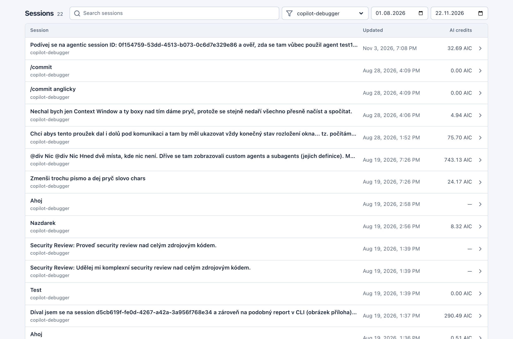

# Copilot Debugger

**See exactly what each Copilot Agent Host session loads, uses, and reports in AI Credits. 100% local, zero telemetry.**

Copilot Debugger reads local Copilot Agent Host data and shows session context, turns, models, tools, agents, skills, token usage, reported AI Credits, and configurable local cost estimates in a compact web UI. Nothing leaves your machine.

<!-- TODO: hero GIF here — 10-15s loop showing: launch `npx copilot-debugger` → session list → open a session → token/cost breakdown. asciinema or GIF, ~800px wide. -->
<!--  -->

[](https://www.npmjs.com/package/copilot-debugger)
[](https://www.npmjs.com/package/copilot-debugger)
[](https://www.npmjs.com/package/copilot-debugger)
[](LICENSE)

```bash
npx copilot-debugger
```

## Contents

- [Why](#why)
- [What It Is](#what-it-is)
- [Installation](#installation)
- [Changelog](#changelog)
- [Troubleshooting](#troubleshooting)
- [Screenshots](#screenshots)
- [Architecture](#architecture)
- [Author](#author)
- [Contribute](#contribute)
- [License](#license)

## Why

Copilot Chat is a black box. You don't see what's actually happening inside a session until it's slow, expensive, or both. Copilot Debugger opens that box:

- **A session feels slow or bloated** — see which turns, tools, and agents ate the context window.
- **You're moving to usage-based billing (AI Credits)** — check reported AIC usage and convert it with your own local rate *before* it hits your invoice.
- **You want to understand model behavior** — inspect which models ran, what tools they called, and how much each turn cost.

Everything runs on your machine. No account, no cloud, no data leaving your laptop.

## What It Is

Copilot Debugger reads the shared Copilot Agent Host session store and shows it in a compact web UI.

It scans Agent Host storage, normalizes sessions, and displays the context inventory separately from runtime tool usage.

For sessions that persist the required source text, the initial context is split into system prompt, user instructions, agent, skill, tool and MCP definitions, conversation, and other attached context. Each segment can be opened to inspect its contents. Missing catalogs or definitions are shown as unavailable instead of being inferred from runtime calls. The detail view also shows the latest context-window state below the conversation: an explicit compaction/shutdown snapshot includes its category breakdown, while sessions without one use the latest persisted main request total.

If the event stream is unavailable but `session-store.db` contains `turns`, the detail view reconstructs those user/assistant turns and marks the missing event detail in the session warnings.

**Privacy:** The app does not send your data anywhere. It reads files from your machine and serves the UI locally. It does not call GitHub, Microsoft, Copilot, or any external analytics API.

Default data sources:

- `~/.copilot/session-store.db`
- `~/.copilot/session-state/<session-id>/events.jsonl` and legacy Agent Host `~/.copilot/session-state/<session-id>.jsonl`
- `~/.copilot/session-state/<session-id>/workspace.yaml`
- VS Code `agentHostCustomizations/<session-id>.json` snapshots for session-scoped instructions, agents, and skills
- `~/.copilot/logs/process-*.log` for MCP servers initialized when the session starts

The Agent Host database is opened read-only with WAL support. Session lists use the compact database and YAML metadata; large event streams are parsed only when a detail is opened. Unknown or malformed events are skipped without hiding the rest of the session.

## Installation

Requirements:

- Node.js 20.9 or newer
- Copilot Agent Host with local session data

Run the published package:

```bash
npx copilot-debugger
```

Local development:

```bash
npm install
npm run dev
```

Default local URLs:

- Web UI: `http://127.0.0.1:5173`
- API: `http://127.0.0.1:4317`

Useful commands:

```bash
npm run typecheck
npm test
npm run build
npm run start
```

Optional environment variables:

- `PORT` - backend port
- `COPILOT_DEBUGGER_AGENT_ROOT` - custom Copilot Agent Host root (default `~/.copilot`)
- `COPILOT_DEBUGGER_CUSTOMIZATIONS_ROOT` - custom VS Code Agent Host customization snapshot root
- `SESSION_POLL_INTERVAL_MS` - fallback refresh interval

Example:

```bash
COPILOT_DEBUGGER_AGENT_ROOT="/path/to/.copilot" npm run dev
```

## Changelog

Release notes are maintained in [CHANGELOG.md](CHANGELOG.md).

## Troubleshooting

- No sessions are shown: check `~/.copilot/session-state` and `~/.copilot/session-store.db`.
- Wrong Agent Host location: set `COPILOT_DEBUGGER_AGENT_ROOT` explicitly.
- Session shows incomplete data: the event stream or `session-store.db` may be absent, locked, or from a newer internal schema. Available data remains visible and the UI shows a warning.
- Port is already used: set `PORT`, for example `PORT=4321 npm run dev`.
- Broken or incomplete data: Copilot Agent Host storage formats are not a stable public API and may change between clients or Agent Host versions.
- TypeScript errors after changes: run `npm run typecheck` before debugging runtime behavior.

## Screenshots

<!-- TODO: consider replacing static shots with a short GIF per view, or at least bump these to full-width. Drop the placeholder cell below. -->

| Session list | Session detail |
| :---: | :---: |
| [](docs/cd1.png) | [](docs/cd2.png) |
| **Model usage** | |
| [](docs/cd3.png) | |

## Architecture

Main stack:

- React + Vite frontend in `src/`
- Node.js + Express backend in `server/`
- REST API under `/api/*`
- `CopilotAgentHostSource` reads only the current Agent Host storage model
- Usage comes from read-only SQLite; detailed turns and the initial context inventory come from lazy JSONL parsing, with stored SQLite turns as a fallback when the event stream is missing
- Session-scoped instructions, agents, and skills are enriched from VS Code Agent Host customization snapshots
- Initialized MCP servers come from the matching Agent Host process lifecycle log

## Author

- Mirek Holec
- Microsoft MVP
- Web: [holec.ai](https://www.holec.ai)
- GitHub: [mirekholec](https://github.com/mirekholec)

## Contribute

Issues and pull requests are welcome. Keep changes small, focused, and tested with `npm run typecheck`.

## License

MIT. See [LICENSE](LICENSE).