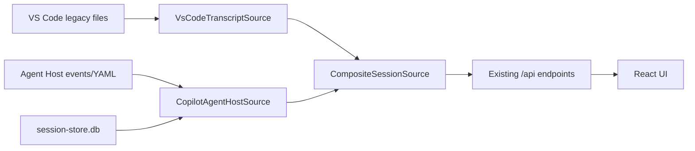

# Migrace na úložiště Copilot Agent Host

Stav průzkumu: 9. srpna 2026

## Shrnutí

Microsoft/GitHub přesouvá Copilot session z úložiště rozšíření VS Code do sdíleného runtime Copilot Agent Host. Pro Copilot harness je hlavní kořen na macOS `~/.copilot` a nová session typicky používá:

```text
~/.copilot/
  session-state/<session-id>/events.jsonl
  session-state/<session-id>/workspace.yaml
  session-state/<session-id>/session.db
  session-store.db
```

Změna vyžaduje nový backendový datový zdroj a nový parser, ne přepis celé aplikace. Stávající `SessionSource` už odděluje REST API a frontend od fyzického formátu. Doporučený postup je:

1. Zachovat `VsCodeTranscriptSource` pro staré VS Code session.
2. Přidat `CopilotAgentHostSource` pro `~/.copilot`.
3. Sloučit oba zdroje přes `CompositeSessionSource`.
4. Číst eventy tolerantně a streamovaně.
5. Použít `session-store.db` jako primární zdroj přesné spotřeby a jako katalog, ale detail konverzace skládat z `events.jsonl`.
6. Ve frontendu pouze rozšířit označení zdroje a degradované stavy; současné endpointy lze zachovat.

Největší technická změna není formát jednotlivého eventu, ale objem dat a rozdělení jedné session mezi event stream, YAML metadata a globální SQLite databázi.

## Rozsah průzkumu

Průzkum proběhl nad reálným `~/.copilot` a nad aktuální implementací aplikace. V okamžiku měření obsahovalo úložiště:

| Položka | Počet / velikost |
| --- | ---: |
| Celé `~/.copilot` | 5,1 GB |
| `session-state` | 1,3 GB |
| Adresáře session | 1 370 |
| Adresářové `events.jsonl` | 706 souborů, přibližně 260 MB |
| Starší kořenové `<id>.jsonl` | 160 souborů |
| `workspace.yaml` | 1 206 |
| Per-session `session.db` | 378 |
| `vscode.metadata.json` | 822 |
| Session v `session-store.db` | 740 |
| Usage záznamy v `session-store.db` | 1 039 |

Kořenové `session-state/<id>.jsonl` a novější `session-state/<id>/events.jsonl` měly v tomto vzorku disjunktní ID. Jde o dvě generace uložení, nikoliv duplicitní kopie. Reader musí podporovat obě.

Pozorované hodnoty `workspace.yaml.client_name`:

| Klient | Pozorovaný počet |
| --- | ---: |
| `github/cli` | 192 |
| `vscode-agent-host` | 49 |
| `vscode` | 7 |
| `copilot-intellij` | 1 |

To potvrzuje, že `~/.copilot` je sdílené úložiště více klientů. Aplikace nesmí předpokládat, že každá session vznikla ve VS Code.

## Veřejný a interní kontrakt

Oficiální dokumentace Copilot CLI a Copilot SDK potvrzuje perzistentní session, `listSessions()`, `resumeSession()` a živé usage eventy. Nezdokumentovává ale schéma `events.jsonl`, `workspace.yaml` ani tabulek `session-store.db` jako stabilní veřejné API.

Z toho plyne:

- Parser lokálních souborů je integrace nad interním formátem a musí být verzovaný, tolerantní a krytý fixture testy.
- Copilot SDK je vhodný budoucí doplňkový zdroj pro živé session a validaci, ne náhrada read-only historického readeru. Automatické spouštění CLI by změnilo dnešní vlastnost aplikace „pouze lokálně čte existující data“.
- Neznámý event nebo nový sloupec nesmí zneplatnit celou session.
- Formát je potřeba detekovat podle obsahu, ne podle verze nainstalovaného VS Code.

Relevantní veřejné podklady:

- [Copilot CLI session API](https://github.com/github/copilot-cli/blob/main/_autodocs/session-api.md)
- [Copilot SDK: usage and billing](https://github.com/github/copilot-sdk/blob/main/docs/features/usage-and-billing.md)
- [Copilot SDK: debugging a listSessions](https://github.com/github/copilot-sdk/blob/main/docs/troubleshooting/debugging.md)

## Mapa úložiště

### Autoritativní zdroje

| Cesta | Role | Doporučení |
| --- | --- | --- |
| `session-state/<id>/events.jsonl` | Úplný append-only event stream nové generace | Primární zdroj detailu session |
| `session-state/<id>.jsonl` | Starší jednosouborová generace stejného eventového modelu | Podporovat jako fallback/legacy Agent Host |
| `session-state/<id>/workspace.yaml` | Název, cwd, git root, repo, branch, klient, časy, remote ID | Primární metadata session, pokud existuje |
| `session-store.db` | Globální katalog, zjednodušené turns, přesná usage data, soubory, reference, checkpointy | Primární zdroj spotřeby; sekundární katalog a fallback |

### Doplňkové zdroje

| Cesta | Obsah | Použití |
| --- | --- | --- |
| `session-state/<id>/plan.md` | Aktuální plán session | Volitelný budoucí detail |
| `session-state/<id>/checkpoints/*` | Kompakční checkpointy | Budoucí vizualizace kompakcí |
| `session-state/<id>/vscode.metadata.json` | Původ a časy VS Code kompatibility; často prázdné | Jen doplňkové obohacení |
| `vscode.session.metadata.cache.json` | Starší VS Code metadata, custom title a worktree změny | Volitelný legacy enrichment; není aktuální katalog |
| `vscode.session.worktree.jsonl` | Mapování starších session ID na worktree cestu | Volitelný fallback workspace názvu |
| `sidebar-sessions-state/*.json` | `cwd` a seznam session zobrazených v CLI sidebaru | Prezentační stav, ne autoritativní katalog |

### Zdroje, které aplikace nemá používat

| Cesta | Důvod |
| --- | --- |
| `session-state/<id>/session.db` | V pozorované verzi obsahuje pouze `inbox_entries` pro mezisession komunikaci, ne transcript ani usage |
| `data.db` | Databáze Copilot Desktop; obsahuje nesouvisející workspace data a citlivé autentizační údaje |
| `logs/` | Provozní diagnostika, ne stabilní session model; může obsahovat citlivá data |
| `config.json`, `settings.json`, auth/MCP adresáře | Konfigurace a potenciální secrets, pro viewer nejsou potřeba |
| `inuse.*.lock` | Pouze indikace aktivní session; data se z něj nečtou |

## Formát event streamu

Každý řádek je samostatný JSON objekt se stabilním vrškem:

```json
{
  "id": "event-id",
  "parentId": "parent-event-id",
  "timestamp": "2026-08-09T19:46:57.399Z",
  "type": "session.start",
  "data": {}
}
```

V pozorovaném vzorku má `session.start.data.version` hodnotu `1`. Reader ji má evidovat, ale nemá odmítat vyšší verzi, pokud umí z eventu získat známá pole.

### Eventy potřebné pro současné funkce

| Event | Důležitá pole | Použití v aplikaci |
| --- | --- | --- |
| `session.start` | `sessionId`, `producer`, `copilotVersion`, `startTime`, `selectedModel`, `reasoningEffort`, `context` | Identita, producent, verze, model, workspace |
| `session.resume` | `resumeTime`, `selectedModel`, `eventCount`, `context.cwd` | Obnovení session a změna času/modelu |
| `session.context_changed` | `cwd`, `gitRoot`, `repository`, `branch`, commity | Aktualizace workspace v průběhu session |
| `session.model_change` | `previousModel`, `newModel`, reasoning | Model timeline |
| `user.message` | `content`, `transformedContent`, `attachments`, `interactionId`, `delivery` | Uživatelské kolo a přílohy |
| `assistant.turn_start` | `turnId`, `interactionId` | Začátek kola a vazba na user message |
| `assistant.message` | `messageId`, `model`, `content`, `toolRequests`, `interactionId`, `turnId`, `outputTokens` | Odpověď a požadavky na tools |
| `assistant.turn_end` | `turnId` | Konec kola |
| `tool.execution_start` | `toolCallId`, `toolName`, `arguments`, `model`, `turnId` | Kanonický začátek tool callu |
| `tool.execution_complete` | `toolCallId`, `success`, `result`, `toolTelemetry`, `turnId` | Výsledek, délky vstupu/výstupu a telemetry |
| `external_tool.requested` | `requestId`, `toolCallId`, `toolName`, `arguments` | Tool delegovaný do VS Code/IDE |
| `external_tool.completed` | `requestId` | Dokončení externí delegace |
| `skill.invoked` | `name`, `path`, `content`, `description`, `source`, `model` | Použité skills a jejich velikost |
| `subagent.started` | `toolCallId`, `agentName`, `agentDescription`, `model` | Začátek subagenta |
| `subagent.completed` | `toolCallId`, `agentName`, `model`, `totalToolCalls`, `totalTokens`, `durationMs` | Souhrn subagenta |
| `system.message` | `role`, `content`, `interactionId` | Celý system prompt pro context overview |
| `session.usage_checkpoint` | kumulativní `totalNanoAiu`, model cache | Nouzový fallback ceny, ne per-request usage |
| `session.compaction_start` / `session.shutdown` | `currentTokens`, `systemTokens`, `conversationTokens`, `toolDefinitionsTokens` | Context breakdown snapshot; poslední dostupný snapshot je `finalContext` |
| `session.compaction_complete` | tokeny před/po, checkpoint, usage kompakce | Samostatná compaction událost a diagnostika |
| `session.binary_asset` | `assetId`, MIME, `byteLength`, base64 `data` | Binární přílohy; při listování přeskočit payload |
| `session.handoff` | source/remote session ID, repo, summary | Vazba cloud-to-local |

Další pozorované eventy jsou permissions, hooks, změny plánu/módu, abort, task completion, shutdown a notifikace. Pro první migrační verzi je stačí bezpečně ignorovat nebo uchovat jen jako diagnostické počty.

### Vazby mezi eventy

- `interactionId` spojuje `user.message`, `assistant.turn_start` a `assistant.message`.
- `turnId` spojuje assistant message a tool eventy uvnitř kola.
- `toolCallId` spojuje požadavek, execution start/complete, permissions a subagenta.
- `requestId` spojuje externí IDE tool request/completion.
- `id`/`parentId` tvoří obecný eventový strom a slouží jako fallback při chybějících specializovaných ID.
- Pozorovaný eventový `turnId` je nulově indexovaný (`"0"`), zatímco `session-store.db.turn_index` je v ověřeném vzorku jedničkově indexovaný (`1`). Toto musí mít explicitní test.

## Globální `session-store.db`

Pozorované schéma má `schema_version = 6` a `PRAGMA user_version = 0`. Kompatibilitu proto kontrolovat přes tabulku `schema_version` a feature detection tabulek/sloupců, ne přes `user_version`.

### Tabulky relevantní pro aplikaci

| Tabulka | Účel |
| --- | --- |
| `sessions` | `id`, `cwd`, `repository`, `branch`, `summary`, časy, `host_type` |
| `turns` | Zjednodušený user/assistant text a timestamp podle `turn_index` |
| `assistant_usage_events` | Per-request model, tokeny, cache, reasoning, AIC, latency a subagent vazby |
| `session_files` | Soubory dotčené session, tool a turn |
| `session_refs` | Reference na externí objekty |
| `checkpoints` | Strukturované souhrny kompakcí |
| `forge_trajectory_events` | Příkazové/trajectory události pro některé režimy |

`assistant_usage_events` je pro současnou aplikaci nejcennější nová tabulka. Obsahuje:

- `model`
- `input_tokens`, `output_tokens`
- `cache_read_tokens`, `cache_write_tokens`
- `reasoning_tokens`
- `total_nano_aiu`, `request_multiplier`
- `duration_ms`, `time_to_first_token_ms`, `inter_token_latency_ms`
- `agent_id`, `parent_tool_call_id`, `turn_index`
- `initiator`, `api_endpoint`, `reasoning_effort`, `finish_reason`
- `token_details_json`

Součet `total_nano_aiu / 1_000_000_000` dává AIC session. `session.usage_checkpoint.totalNanoAiu` je kumulativní checkpoint; jeho hodnoty se nikdy nesmí sčítat mezi sebou ani přičíst k DB záznamům.

SQLite se během aktivní session zapisuje ve WAL režimu. Reader musí:

- používat SQLite knihovnu, ne spouštět systémový `sqlite3` proces,
- otevřít databázi read-only tak, aby četl i `-wal`,
- nastavit krátký busy timeout a retry,
- při locku nebo chybě degradovat na event-only data,
- kontrolovat existenci tabulek/sloupců před dotazem,
- nikdy databázi nemigrovat ani do ní zapisovat.

## Mapování dnešního datového modelu

### `NormalizedSession`

| Dnešní pole | Nový zdroj | Poznámka |
| --- | --- | --- |
| `id` | adresář/soubor, `session.start.data.sessionId`, DB `sessions.id` | Při neshodě preferovat event payload a zaznamenat warning |
| `workspaceStorageId` | nemá přímý ekvivalent | Deprecate; zavést `workspaceKey`, odvozený z normalizovaného `cwd`/repo |
| `workspaceName` | basename `workspace.yaml.cwd`, fallback DB `cwd` | Neodvozovat z ID storage adresáře |
| `sourcePaths` | event stream, YAML, globální DB | Rozšířit kontrakt o `events`, `workspaceMetadata`, `sessionStore` |
| `startTime` | `session.start.startTime`, fallback DB `created_at`, file birth time | Event je primární |
| `updatedAt` | `workspace.yaml.updated_at`, DB `updated_at`, poslední event/file mtime | Vzít maximum validních časů |
| `producer` | `session.start.data.producer` | Pozorováno `copilot-agent` |
| `copilotVersion` | `session.start.data.copilotVersion` | Např. řady `0.0.x` i `1.0.x` |
| `vscodeVersion` | v novém formátu typicky není | Zavést `clientName`; pro `vscode-agent-host` verzi nefalšovat |
| `firstUserMessage` | první `user.message.data.content` | Ignorovat hook kopie promptu |
| `messageCount` | počet `user.message` + `assistant.message` | Nezapočítat system/hook/tool eventy |
| `userTurnCount` | počet logických `interactionId`, fallback počet `user.message` | Steering message může přijít uvnitř kola |
| `agents` | `subagent.*.agentName`, DB `assistant_usage_events.agent_id` | Deduplikovat a řadit |
| `tools` | `tool.execution_start.toolName`, `external_tool.requested.toolName` | Deduplikovat podle `toolCallId` |
| `hasDebugLog` | event stream existuje | Přejmenovat na `hasDetailedEvents`, staré pole přechodně zachovat |
| `cost` | primárně `assistant_usage_events` | Event checkpoint jen fallback |

Doporučená nová metadata:

- `sourceKind: 'vscode-legacy' | 'copilot-agent-host'`
- `clientName: 'github/cli' | 'vscode-agent-host' | 'vscode' | 'copilot-intellij' | string`
- `repository`, `branch`, `hostType`
- `schemaVersion`
- `dataCompleteness` nebo seznam warnings, aby UI poznalo chybějící DB/eventy

### `TurnInfo` a `AgentTurnInfo`

Sestavení kola:

1. Seřadit validní eventy podle timestampu a při shodě zachovat pořadí souboru.
2. Vytvořit kolo z `assistant.turn_start`.
3. Připojit user message přes `interactionId`; fallback je poslední dosud nepřiřazená `user.message`.
4. Připojit `assistant.message` a tools přes `turnId`.
5. Tool call vytvořit jednou z `tool.execution_start`; doplnit výsledek z `tool.execution_complete`.
6. `external_tool.*` použít k doplnění IDE toolů, ale neduplikovat stejný `toolCallId`.
7. DB usage řádky připojit podle normalizovaného `turn_index`, timestampu a případně `parent_tool_call_id`.
8. Subagent vytvořit z `subagent.started/completed`; jeho usage je v DB přes `agent_id` a `parent_tool_call_id`, nikoliv v samostatném child JSONL.

Na rozdíl od starých debug logů jsou subagenti součástí stejného streamu. `parseSubagentFiles()` proto pro nový source nebude potřeba. Pokud event stream chybí, lze top-level turns a jejich uložené texty rekonstruovat z tabulky `turns`; dostupné usage requesty se připojí jako interní modelové turns.

### `SessionOverview`

| Dnešní přehled | Nová dostupnost |
| --- | --- |
| Celý system prompt | Ano, `system.message.data.content` |
| Skills | Ano: dostupné lze parsovat ze system promptu, skutečně použité ze `skill.invoked` |
| Agents | Ano: katalog ze system promptu, použití ze `subagent.*` |
| Attachments | Ano: `user.message.attachments` + `session.binary_asset` |
| Použité tools | Ano: execution/external tool eventy |
| Definice všech připojených tools | Neprokázáno jako samostatný perzistentní payload |
| Velikost tool definitions | Částečně: `session.compaction_start.toolDefinitionsTokens`, ne přesné JSON bytes |
| Context token breakdown | Přesný breakdown při kompakci nebo shutdownu: system/conversation/tool definitions tokens; UI zobrazuje první snapshot nahoře a poslední snapshot dole. Pokud explicitní snapshot chybí, spodní proužek použije poslední hlavní `assistant_usage_events.input_tokens` jako aktuální celkový počet bez falešného rozdělení do kategorií |
| Max context window | V perzistentních datech není spolehlivě přítomen; živě jej nabízí SDK usage event |

UI nesmí zaměnit „použité tools“ za „všechny připojené tools“. Pokud nejsou definice dostupné, `connectedSessionCount`, descriptions, deferred flags a schema size musí být označené jako nedostupné, nikoliv dopočítané z použití.

Při absenci `events.jsonl` se detail session nesmí zahodit, pokud jsou v `session-store.db` uložené turns. UI v takovém případě zobrazí rekonstruované user/assistant texty, dostupné usage requesty a varování o nedostupném detailním event streamu.

Pro byte metriky používat UTF-8 `Buffer.byteLength()`, ne JavaScript `string.length`.

## Navržená architektura



### Backendové komponenty

- `CopilotAgentHostSource`
  - discovery a snapshot lifecycle,
  - spojení event/YAML/SQLite dat,
  - implementace současného `SessionSource`.
- `AgentHostEventReader`
  - streamovaný tolerantní JSONL parser,
  - fold eventů do session/turn struktur,
  - ignorování neznámých eventů a invalidních řádků.
- `AgentHostStoreReader`
  - read-only SQLite dotazy,
  - feature detection schématu,
  - dávkové načítání usage pro více session bez N+1 dotazů.
- `CompositeSessionSource`
  - souběžný start/stop zdrojů,
  - sjednocený snapshot,
  - routing detailu do vlastníka session,
  - řešení případné kolize ID.

`VsCodeTranscriptSource` se nemá rozšiřovat o další sadu globů a podmínek. Už dnes je velký a nový event model má jinou identitu, vazby i cost semantics. Samostatná implementace sníží riziko regresí starých session.

## Discovery, refresh a výkon

Současný refresh čte všechny kandidátní JSONL od začátku. Nad pozorovanými 260 MB eventů a 1,3 GB session state by to při každém pollu bylo neudržitelné.

Požadovaný návrh:

- Pro seznam session použít jeden dávkový dotaz do `session-store.db` a malé `workspace.yaml`; nečíst celé eventy.
- Event stream načíst až pro detail nebo pro session, jejíž mtime/velikost se změnila.
- Udržovat cache `{path, size, mtimeMs, parsedOffset, partialLine}`.
- Aktivní append-only soubor dočítat od posledního kompletního řádku.
- Při zmenšení/nahrazení souboru zahodit cache a načíst jej znovu.
- Binární `session.binary_asset.data` při indexaci nepřenášet ani nekopírovat.
- Watchovat `session-state` s omezenou hloubkou a `session-store.db`, `-wal`, `-shm`; polling ponechat jako fallback.
- Debounce změn aplikovat per source, aby zápis eventu a DB usage nevyvolal dvě úplná přepočítání.
- Aggregate tools/models počítat z cache, ne opakovaným načítáním každého detailu.

Default rooty:

- macOS/Linux: `~/.copilot`
- Windows: `%USERPROFILE%\.copilot`

Přidat vlastní proměnnou například `COPILOT_DEBUGGER_AGENT_ROOT`; nepoužívat obecné jméno, které by mohlo kolidovat s runtime Copilotu. Stávající `VSCODE_*` proměnné zachovat.

## Bezpečnost a soukromí

Nový stream obsahuje výrazně citlivější data než dnešní normalizovaný výstup:

- celý system prompt a custom instructions,
- uživatelské prompty a odpovědi,
- argumenty a výsledky tools,
- lokální absolutní cesty,
- přílohy a base64 binární data,
- remote task/session ID,
- potenciální secrets vypsané nástrojem nebo terminálem.

Požadavky:

- REST API nadále vrací jen explicitně normalizovaná pole.
- Nepřidávat endpoint pro raw event stream bez samostatného bezpečnostního návrhu.
- Nelogovat event payloady při parse chybě.
- Omezit délky textů, tool detailů a výsledků před odesláním do UI.
- `data.db`, auth a config soubory explicitně ignorovat.
- Při budoucím exportu zavést redakci cest, tokenů a binárních dat.
- Zachovat bind serveru pouze na loopback a stávající Host guard.

## Migrační plán

### Fáze 0: Fixture corpus a kontrakt

- Vytvořit anonymizované fixtures z několika generací `events.jsonl` a minimální SQLite fixture se schématem 6.
- Pokrýt VS Code Agent Host, `github/cli`, starší root `<id>.jsonl`, session bez DB a session bez eventů.
- Zapsat očekávané normalized JSON snapshoty pro list, turns, overview a costs.
- Rozšířit `SessionSource` o source/client/completeness metadata bez odstranění starých polí.

Výstup: testy nejprve selžou proti chybějícímu Agent Host source a současný legacy source zůstane beze změny.

### Fáze 1: Read-only katalog

- Přidat default root `~/.copilot` a konfigurační override.
- Implementovat SQLite reader s read-only WAL a schema feature detection.
- Načíst `sessions` a agregovanou `assistant_usage_events` jedním/dvěma dávkovými dotazy.
- Doplnit metadata z `workspace.yaml`, event hlavičky a file stats podle jasné precedence.
- Zprovoznit `/api/sessions`, `/api/sessions/:id` a model/cost agregace.

Výstup: nové session jsou v seznamu se správným workspace, modelem, tokeny a AIC bez čtení všech eventů.

### Fáze 2: Turns a tools

- Implementovat event fold podle `interactionId`, `turnId`, `toolCallId` a `parentId`.
- Připojit usage requesty z DB a subagenty přes `parent_tool_call_id`.
- Deduplikovat assistant tool request, execution event a external IDE event.
- Zprovoznit `/api/sessions/:id/turns`.
- Přidat degradovaný režim pro chybějící/locked DB.

Výstup: detail session zachová modely, tokeny, tools, subagenty a browser/attachment kontext.

### Fáze 3: Overview a aggregate tools

- Parsovat system prompt, skills, agents a attachments z nových eventů.
- Zobrazit použité tools nezávisle na dostupných tools.
- Přidat context token breakdown z compaction eventů.
- V UI označit metriky, které nový perzistentní formát neposkytuje.

Výstup: overview je funkční bez falešných nul pro nedostupná data.

### Fáze 4: Composite source a kompatibilita

- Přidat `CompositeSessionSource` a zapnout oba zdroje v `server/index.ts`.
- Preferovat adresářové Agent Host eventy před root legacy variantou pouze při stejné session identitě; v pozorovaném vzorku se ID nepřekrývala.
- Při kolizi mezi VS Code legacy a Agent Host použít source-qualified interní klíč, ne tiché sloučení různých konverzací.
- Doplnit UI filtr/štítek klienta a zdroje.
- Aktualizovat README, konfiguraci a troubleshooting.

Výstup: jedna instalace ukáže staré VS Code i nové Agent Host session.

### Fáze 5: Inkrementální refresh

- Přidat lazy detail cache a offsetové dočítání aktivních eventů.
- Watchovat nové session adresáře a SQLite WAL.
- Změřit start, refresh, detail a peak memory nad corpus velikosti alespoň 1 GB.
- Ověřit, že aktivní neukončený JSON řádek nezpůsobí chybu ani ztrátu následujícího eventu.

Výstup: běžný refresh neškáluje s celkovou velikostí historie.

### Fáze 6: Volitelné SDK

- Udělat samostatný spike nad `@github/copilot-sdk`/Copilot CLI JSON-RPC.
- Ověřit, co přesně vrací `listSessions()` pro session vytvořené VS Code Agent Host.
- SDK použít jen pro živé limity/context usage nebo budoucí vzdálené session, pokud nevyžaduje mutaci či spuštění nové session.
- File/DB reader ponechat pro historickou analytiku a offline provoz.

## Testovací matice

Minimální automatizované scénáře:

- minimální session s jedním user/assistant kolem,
- více LLM requestů v jednom kole,
- model change uprostřed session,
- tool success, failure a chybějící completion,
- externí VS Code tool a jeho deduplikace,
- subagent s jiným modelem a vlastními usage řádky,
- skill invocation,
- attachment + binary asset bez načtení base64 při listování,
- compaction a checkpoint bez dvojího započtení usage,
- remote handoff a context change,
- session resume,
- malformed JSONL řádek a nedokončený poslední řádek,
- neznámý event a vyšší `session.start.version`,
- chybějící, zamčená nebo novější SQLite DB,
- DB v WAL režimu během zápisu,
- root `<id>.jsonl` legacy generace,
- kolize ID mezi zdroji,
- nulový eventový `turnId` versus jedničkový DB `turn_index`,
- refresh po appendu, truncation a atomic replace,
- parity test současných VS Code fixtures, aby migrace nerozbila staré session.

Nefunkční kritéria:

- list session nesmí načítat base64 assets ani celé tool outputs,
- invalidní řádek nesmí ukončit scan,
- chyba jedné session nesmí skrýt ostatní,
- žádný test ani log nesmí obsahovat reálné prompty, secrets nebo osobní cesty,
- `npm run typecheck` a po backendových změnách `npm run build` musí projít.

## Rozhodnutí a otevřené body

### Doporučená rozhodnutí

- **Zachovat REST a frontendový model jako hlavní kompatibilní hranici.**
- **Implementovat nový source odděleně.** Formáty mají příliš rozdílné vazby pro další větvení ve `VsCodeTranscriptSource`.
- **Použít DB pro přesnou usage, eventy pro detail.** Ani jeden zdroj samostatně neposkytuje všechna data.
- **Podporovat obě Agent Host file generace.** Historie by jinak při migraci zmizela.
- **Preferovat lazy a inkrementální parsing.** Úplný rescan po 30 sekundách není přijatelný.
- **Nečíst `data.db`.** Není potřeba a zbytečně rozšiřuje bezpečnostní riziko.

### Otevřené implementační body

- Výběr portable Node SQLite knihovny při zachování současného minima Node 20.9. Nepoužívat shell `sqlite3`; před rozhodnutím ověřit prebuildy pro podporované OS/architektury a chování s aktivním WAL.
- Zda frontend potřebuje zobrazit `cache_write_tokens` a `reasoning_tokens`, které současný kontrakt nemá.
- Jak prezentovat tools dostupné vs. skutečně použité, když persisted tool definitions nejsou vždy dostupné.
- Zda se má `workspaceStorageId` odstranit v jednom breaking releasu, nebo přechodně mapovat na nový `workspaceKey`.
- Zda zahrnout čisté CLI/IntelliJ session defaultně, nebo přidat filtr klienta. Doporučení je zahrnout je a transparentně zobrazit `clientName`.
- Jak dlouho držet detail cache a zda ji perzistovat. První verze má použít pouze in-memory cache, aby aplikace nevytvářela vlastní kopii citlivých transcriptů.

## Akceptační kritéria migrace

Migrace je hotová, pokud:

- aplikace automaticky najde nové `vscode-agent-host` session v `~/.copilot`,
- staré VS Code session zůstanou viditelné,
- list nevyžaduje kompletní scan všech eventů,
- detail správně seskupí messages, LLM requesty, tools a subagenty,
- tokeny, cache a AIC odpovídají součtu `assistant_usage_events`,
- cumulative checkpoint usage se nezapočítá podruhé,
- aktivní WAL/append zápis nezpůsobí pád ani nekonzistentní globální snapshot,
- session bez DB nebo s poškozeným řádkem zůstane částečně zobrazitelná,
- UI nezobrazuje nedostupné metriky jako skutečnou nulu,
- raw system prompt, tool output ani binární data neopustí normalizační vrstvu bez explicitního rozhodnutí.